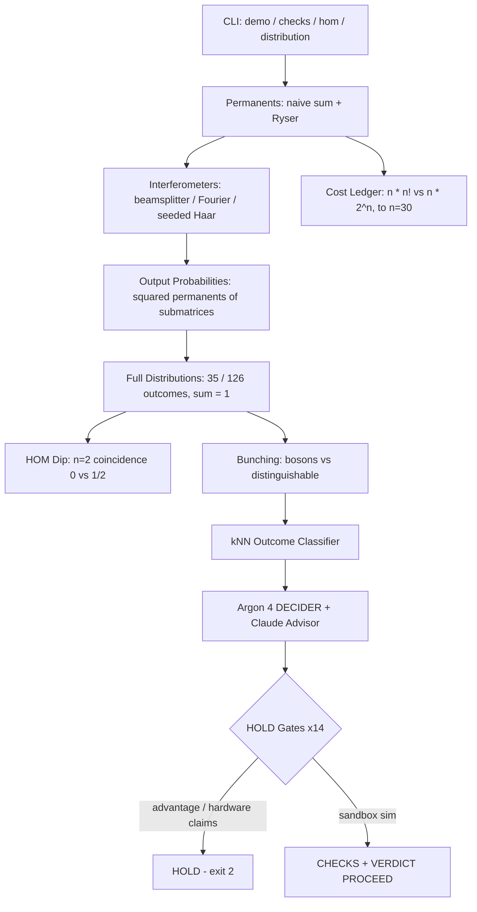
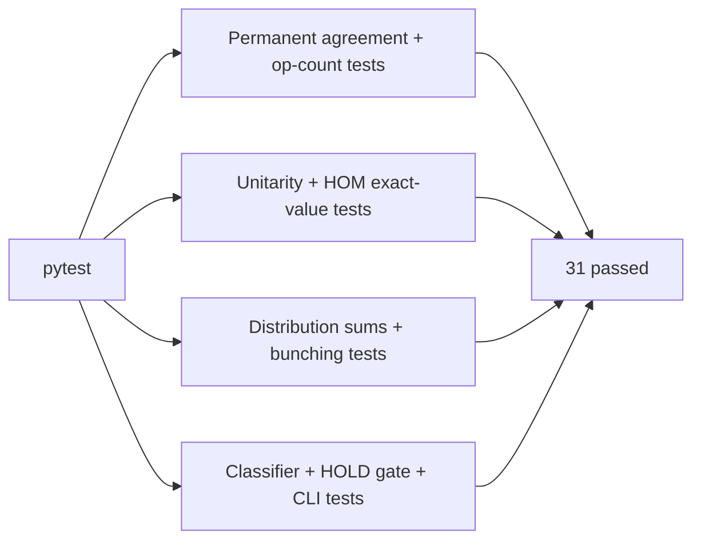
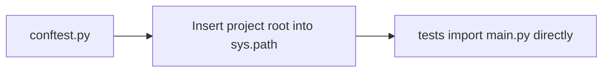
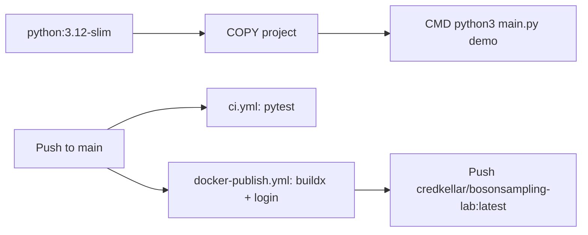

# BosonSampling-Lab 🔆⚛️

**Boson Sampling & Matrix Permanent Lab** — by Darion Kellar

BosonSampling-Lab is an **educational boson sampling lab** in ONE pure-Python file. It builds the experiment that made permanents famous — n identical photons through an m-mode interferometer — and computes every output probability **exactly**, from scratch, two independent ways:

- **The permanent, twice** — the naive permutation sum (the definition itself) and **Ryser's inclusion–exclusion formula**, asserted equal on every matrix the lab trusts. The permanent is the determinant's cousin with the sign removed, and that missing sign is the whole story: there is no row-reduction shortcut, so the best exact classical cost is still ~n·2ⁿ per permanent.
- **The interferometers** — a 50/50 beamsplitter, the **Fourier multiport** (n = 3 in m = 5, n = 4 in m = 6), and a **seeded Haar-style unitary** built by Gram–Schmidt on a deterministic Gaussian draw — each asserted unitary to ~1e-16 before a single photon is allowed through.
- **The distributions, whole** — every output occupation enumerated (35 outcomes at n = 3, 126 at n = 4), never sampled, so the probabilities must sum to exactly 1 — and the checks assert they do. The **Hong–Ou–Mandel dip** falls out as the n = 2 special case: coincidence exactly 0 for indistinguishable photons, exactly 1/2 for distinguishable ones.
- **The ledger** — the classical cost is printed as operation counts at the lab's sizes and extrapolated to n = 20 and n = 30, where one naive permanent costs 7.96e33 multiplications. The hardness claim is a ledger, not a slogan.

Honest scope, stated up front: these are **toy sizes on a classical laptop** — no photonic chip, no measured data, and **no quantum advantage demonstrated or claimed**. At n = 4 the laptop is not the bottleneck; the exponential is. Every advantage / hardware / vendor / certified-randomness claim sits behind a permanent HOLD gate (14 total). 🔒

[](https://github.com/kimanicollier44-cmyk/BosonSampling-Lab/actions/workflows/ci.yml)
[](https://github.com/kimanicollier44-cmyk/BosonSampling-Lab/actions/workflows/docker-publish.yml)

> ℹ️ These are the **live** workflow badges for this repo. They activate as soon as the `ci.yml` and `docker-publish.yml` files from the paste pack are pasted into `.github/workflows/` — until then they have nothing to report yet.

## 🧰 Tech Stack Badges & Full Architecture Tech Stack

### 💻 Core Programming Languages & Core Systems


- 🐍 Python 3.12, pure standard library (`cmath`, `hashlib`, `itertools`, `json`, `math`, `random`, `sys`) — zero dependencies, zero network, deterministic (double-run byte-identical)
- 🔢 Permanent core: the naive permutation sum and Ryser's inclusion–exclusion over column subsets, both from scratch on complex matrices, cross-asserted to <1e-8 on seeded draws up to 5×5 — every output probability in the lab is one squared permanent
- 🔆 Optics core: Fourier multiport `U_jk = exp(2πijk/m)/√m`, a seeded Haar-style unitary (Box–Muller Gaussian stream + Gram–Schmidt QR), unitarity asserted <1e-12 before use
- 🧠 TinyML kNN outcome classifier (from scratch, stdlib, distance-weighted): bosonic-bunched / distinguishable-like / suppressed-coincidence from bunching fraction + coincidence rate + photon number, labels from the lab's own policy
- 🪑 Council seats: Gemini Argon 4 DECIDER (names-only, tighten-only) + Muse advisor (never overrides HOLD) + Google Flow plan-only (rendered = False, live = 0)

### ⛓️ Web3 & Infrastructure

- 🚫 **Not applicable — honestly.** No blockchain, no Web3, no tokens: the "infrastructure" in this lab is a labelled simulation of an interferometer and a permanent ledger inside one offline file. No fake badges here.

### ⚙️ Platform Support & Hardware Architecture


- 🖥️ Pure Python — runs anywhere Python 3.12+ runs (Linux, macOS, Windows), plus the `python:3.12-slim` Docker image
- 🔒 No hardware is controlled, ever: real photonic chips, single-photon sources, phase shifters, and detectors are permanent HOLD gates (see the gate table below)

### ⚡ Low-Level Infrastructure & Performance

- 🚫 **No low-level code — honestly.** No C, no C++, no GPU, no compiled extensions: this is one interpreted Python file on purpose, so every permanent can be read, checked, and diffed. Performance here means honest counting — the lab's own ledger prices the naive sum at n·n! multiplications and Ryser at n·2ⁿ, and shows Ryser only pulls ahead from n = 4 (at n = 3 the naive 18 multiplications still beat Ryser's 24 subset operations — printed, not hidden).

### 🛠️ DevOps & Build Tools


- 🐳 Docker (`python:3.12-slim`), GitHub Actions CI + Docker Publish (delivered in the paste pack)
- 🎯 Target image: `credkellar/bosonsampling-lab:latest`
- 🧪 Tests: `pytest` (31 tests) + the built-in CHECKS suite (44 checks) in `main.py`

### ☁️ Cloud Providers

- 🚫 **None — honestly.** No cloud provider is used or needed: the lab runs fully offline on your own machine or in a local Docker container. Docker Hub appears only as the registry the publish workflow pushes the image to.

## What this does?

1. 🔢 **The permanent, by the definition** — `perm(A) = Σ_p Π_i A[i][p(i)]` summed over all n! permutations with `itertools`. On the lab's seeded 4×4 complex draw it returns −2.697238 + 0.340350i. This is the formula every boson-sampling probability is made of, written out with nowhere to hide.
2. 🧮 **Ryser's formula, independently** — inclusion–exclusion over the 2ⁿ column subsets with alternating signs. It agrees with the naive sum to **9.78e-15** on that same 4×4, and the checks hold the two implementations against each other on seeded matrices at n = 2, 3, 4, 5 before anything downstream is trusted.
3. 💰 **The price list** — one permanent costs n·n! multiplications naively (n = 4: 96; n = 6: 4,320) versus n·2ⁿ by Ryser (n = 4: 64; n = 6: 384). Ryser's win is real but it is still exponential — and at n ≤ 3 the naive sum is actually cheaper, which the ledger prints instead of smoothing over.
4. 🔆 **Interferometers, asserted unitary** — the 50/50 beamsplitter, Fourier multiports at m = 5 and m = 6, and a Haar-style 6×6 from a seeded Gaussian matrix (seed 20261118, Box–Muller + Gram–Schmidt, reproducible to the last bit). Worst unitarity error across all of them: **8.55e-16**.
5. 🕳️ **Hong–Ou–Mandel, as a special case** — run the general machinery at n = 2, m = 2 and the famous dip falls out: bosons give (2,0) = 0.5, **(1,1) = 0.0 exactly**, (0,2) = 0.5. Distinguishable photons on the same beamsplitter give the classical 0.25 / **0.5** / 0.25. No separate HOM code — the dip is the permanent of a 2×2 doing its job.
6. 🎲 **Full distributions, enumerated** — for photons in modes 0..n−1, every occupation pattern gets its exact probability `|perm(U_sub)|² / Π t_j!`: **35 outcomes** at n = 3, m = 5 and **126 outcomes** at n = 4, m = 6, for both the Fourier and the seeded Haar unitaries. Each distribution sums to **1.000000000000** — asserted, because nothing was sampled.
7. 👥 **Bunching, bosons vs distinguishable** — same unitary, two particle types. Fourier n = 3: bosons bunch with probability **0.720000** vs 0.520000 distinguishable. Fourier n = 4: **0.888889** vs 0.722222. Haar n = 4: **0.885271** vs 0.681874. Bosons bunch more and collide less in every system in the lab.
8. 🌰 **The honest edge case** — the seeded Haar draw at n = 3 bunches weakly: **0.500593** bosonic vs 0.278686 distinguishable, with a collision-free rate (0.499407) that looks classical. The lab reports it as a weak draw instead of shopping for a better seed — the classifier below grades it accordingly.
9. 🧱 **The wall, extrapolated** — at n = 20 one permanent is 4.87e19 naive multiplications or 20,971,520 Ryser operations (0.021 s at the labelled 1e9 ops/s). At n = 30: **7.96e33** naive multiplications (≈2.5e17 years at the labelled rate) versus 3.22e10 Ryser operations (32.2 s) — for **one** output probability, in a distribution with astronomically many outcomes. That gap is the entire boson-sampling argument, priced.
10. 🏷️ **Outcome classifier + seats + checks** — a distance-weighted kNN grades measured statistics as suppressed-coincidence (the HOM point), bosonic-bunched (Fourier and Haar at n = 4, Fourier at n = 3), or distinguishable-like (every distinguishable row — and the weak Haar n = 3 draw), with Argon 4 DECIDER (sha256 trace), Muse advisor, Google Flow plan-only, and a built-in CHECKS suite (44 checks).

## 🗺️ How it works — diagram per script

### `main.py` — the whole lab



### `tests/test_main.py` — verification



### `conftest.py` — test path setup



### `Dockerfile` + CI flow — container & publish



## Why is this cool?

1. 🕳️ The Hong–Ou–Mandel dip is **derived, not demonstrated**: one 2×2 permanent, `|U₀₀U₁₁ + U₀₁U₁₀|² = 0`, and the most famous coincidence dip in quantum optics falls out of the general boson-sampling formula.
2. 🔢 Two permanent algorithms that **grade each other**: the naive sum and Ryser agree to 9.78e-15, so every probability downstream rests on arithmetic that has been cross-examined, not trusted.
3. 🧱 The quantum-advantage argument is shown as a **price list**: 32 seconds of Ryser for one n = 30 probability versus 2.5e17 years of naive multiplication — the exponential wall is a number you can recompute, not a vibe.
4. 🎲 Nothing is sampled: the distributions are **enumerated whole** (126 outcomes at n = 4) and sum to 1.000000000000, so bunching fractions are exact probabilities, not Monte-Carlo estimates with error bars.
5. 👥 Bosonic bunching is **measured against its own control**: every unitary is run twice, once for bosons and once for distinguishable particles, so the quantum excess (0.888889 vs 0.722222 at Fourier n = 4) is a difference, not an assertion.
6. 🌰 It **keeps its weak draw**: the seeded Haar unitary at n = 3 bunches at only 0.500593, and the lab prints that, names it weak, and lets its own classifier call it distinguishable-like. No seed shopping.
7. 🔆 The Haar unitary is **reproducible to the bit**: a seeded Box–Muller stream and Gram–Schmidt QR mean anyone, anywhere, rebuilds the exact same interferometer and gets the exact same distribution.
8. 🏷️ The classifier **grades statistics, not identity**: fed only (bunching, coincidence, n), it finds the HOM point as suppressed-coincidence and the n = 4 systems as bosonic-bunched — the verdict is in the numbers.
9. ⚖️ Ryser's formula gets an **honest footnote**: below n = 4 the naive sum is cheaper, and the ledger says so — the lab teaches the crossover instead of chanting "exponential bad".
10. 🎯 Deterministic end to end: run it twice, get byte-identical output — a boson sampler you can diff.

## What problems this solves?

1. ❌ **Problem:** Boson sampling is usually explained with the permanent left as a black box. ✅ **Solution:** The permanent is implemented twice, from the definition and from Ryser's formula, and the two are asserted equal before any physics is built on them.
2. ❌ **Problem:** "Quantum advantage" gets asserted from headlines about photon counts. ✅ **Solution:** The cost ledger prices one permanent at n = 20 and n = 30 as operation counts and labelled times — and states plainly that at the lab's sizes (n ≤ 4) no advantage exists.
3. ❌ **Problem:** The HOM dip is often presented as a separate magic trick. ✅ **Solution:** It is computed by the same distribution code as n = 3 and n = 4 — the dip is the n = 2 row of the general table.
4. ❌ **Problem:** Sampling demos show histograms and call them distributions. ✅ **Solution:** The full Fock space is enumerated (35 / 126 outcomes) and the probabilities are asserted to sum to 1 — exact values, no shot noise.
5. ❌ **Problem:** Bunching claims rarely show the classical baseline. ✅ **Solution:** Every system is also computed for distinguishable particles with the `perm(|U|²)` formula, and both columns are printed side by side.
6. ❌ **Problem:** Random unitaries in papers can't be reproduced. ✅ **Solution:** The Haar-style unitary comes from a labelled seed through a stated construction (Box–Muller + Gram–Schmidt); the checks assert the draw is deterministic and unitary.
7. ❌ **Problem:** Weak or unlucky draws quietly disappear from demos. ✅ **Solution:** The Haar n = 3 draw bunches weakly (0.500593) and stays in the report, in the bunching table, and in the classifier scenarios — labelled weak.
8. ❌ **Problem:** Permanent complexity is quoted as "exponential" without a crossover. ✅ **Solution:** The ledger counts both algorithms at n = 2…6, 20, 30 and shows Ryser losing at n ≤ 3 and winning from n = 4 — the shape of the wall, not just its existence.
9. ❌ **Problem:** Simulation outputs get dressed up as experimental results. ✅ **Solution:** `device_measurement_claim` and `peer_reviewed_result_claim` are permanent HOLD gates; every number is labelled computed.
10. ❌ **Problem:** Toy quantum demos quietly imply a product is next. ✅ **Solution:** 14 named HOLD gates return exit code 2 for every advantage, hardware, benchmark, randomness-certification, or investment claim, forever.

## How to install this?

1. 📋 Clone or download this project folder.
2. 🐍 Make sure Python 3.12+ is installed: `python3 --version`
3. ▶️ Run the full demo + checks (no arguments needed):

```bash
python3 main.py
```

4. 🧪 Run the test suite:

```bash
pip install pytest
python3 -m pytest -q
```

5. 🎛️ Try the other commands:

```bash
python3 main.py checks       # 44 built-in checks
python3 main.py permanent    # naive vs Ryser on a seeded 4x4 + op counts
python3 main.py unitary      # unitarity errors for all interferometers
python3 main.py hom          # Hong-Ou-Mandel report (JSON)
python3 main.py distribution # full distribution report (fourier_n3_m5 default)
python3 main.py bunching     # bunching table, bosons vs distinguishable
python3 main.py ledger       # classical cost ledger to n = 30 (JSON)
python3 main.py classify     # kNN outcome classifier report
python3 main.py brains       # Argon 4 + Muse + Flow seats
python3 main.py holds        # list all 14 HOLD gates
python3 main.py hold-demo    # exits 2 - gated actions stay HOLD
```

6. 🐳 Or run it in Docker:

```bash
docker build -t credkellar/bosonsampling-lab:latest .
docker run --rm credkellar/bosonsampling-lab:latest
```

## Requirements

- 🐍 Python 3.12 or newer
- 📦 Dependencies: **none** (standard library only)
- 🌐 Network: **none** — fully offline
- 🧪 For tests only: `pytest`
- 🐳 Optional: Docker

## FULL project structure tree

```text
bosonsampling-lab/
├── main.py                  # the whole lab: permanents (naive + Ryser), interferometers, HOM, distributions, bunching, cost ledger, classifier, seats, HOLD gates
├── conftest.py              # puts the project root on sys.path for tests
├── tests/
│   └── test_main.py         # 31 pytest tests: permanents, unitaries, HOM, distributions, bunching, classifier, gates, determinism
├── assets/
│   └── cover.png            # README cover image (2736 x 912)
├── Dockerfile               # python:3.12-slim, runs the demo
├── .gitignore               # __pycache__/, .pytest_cache/, *.pyc
└── README.md                # this file
```

> 📦 Delivered separately as paste packs (not in this tree): `.github/workflows/ci.yml` + `docker-publish.yml`, and the Docker Hub pack (100-char description, 350-char About, overview, categories).

## 🔒 HOLD gates — all 14, permanent

| # | Gate | What stays held |
|---|------|-----------------|
| 1 | `quantum_advantage_claim` | No quantum advantage claim; toy sizes run fastest on the laptop that computed them |
| 2 | `quantum_supremacy_claim` | No supremacy demonstration; n = 2, 3, 4 photons is a teaching regime, not a frontier |
| 3 | `photonic_hardware_control` | No control of real photonic chips, sources, phase shifters, or detectors |
| 4 | `device_measurement_claim` | No presenting computed permanents as data measured from a real device |
| 5 | `vendor_benchmark_claim` | No vendor benchmark claims; the operation ledger is not a product comparison |
| 6 | `certified_randomness_claim` | No certified randomness; a computed distribution is not a randomness beacon |
| 7 | `cryptographic_use_claim` | No cryptographic keys, proofs, or protocols derived from sampling outputs |
| 8 | `production_sampling_claim` | No production sampling service; this is an offline teaching lab |
| 9 | `chip_fabrication_claim` | No chip design or fabrication guidance from toy unitaries |
| 10 | `scaling_guarantee_claim` | No guarantee that any device scales to the advantage regime |
| 11 | `investment_claim` | No investment claims; a permanent ledger is not a prospectus |
| 12 | `hardware_specification_claim` | No hardware specification; labelled unitaries are not device specs |
| 13 | `remove_human_override` | The human override is never removed |
| 14 | `peer_reviewed_result_claim` | No claim of a peer-reviewed or published experimental result |

🧑‍⚖️ **Council seats:** Gemini Argon 4 Extended Thinking — DECIDER (names-only, tighten-only, MAP → MODEL → STRESS → DECIDE, sha256 trace, `can_override_hold = False`) · Muse — advisor (`can_override_hold = False`) · Google Flow — plan-only (`rendered = False`, `live = 0`).

✅ **Verification:** pytest **31 passed** (project + clean copy) · built-in CHECKS **44/44** · double-run output **byte-identical** · `hold-demo` exits **2** · `main.py` **798 lines**, pure stdlib, zero network.

## 🧒 5th-grade English section

Imagine you have a machine with several doors in and several doors out, and you roll identical marbles through it — except these marbles are made of light, and light marbles are *weird*. 🔆

- When two light marbles go in at the same time, they **like to leave together** through the same door. Scientists call this **bunching**. Ordinary marbles don't care; light marbles do — and this lab counts exactly how often each kind bunches: at one setting, light marbles bunch 89 times out of 100, ordinary ones only 72.
- There is a famous trick with a half-silvered mirror: send one light marble in each side door at the same moment, and they **never** come out one-per-door — they always leave together. This is called the **Hong–Ou–Mandel dip**, and in this lab it isn't a trick at all: it's just one row of the same counting table as everything else.
- To predict the odds for each exit pattern, you need a special kind of adding-and-multiplying called a **permanent**. For 2 marbles it's easy. For 4 it's fine. For 30 marbles, even the fastest known recipe needs more steps than a laptop could do in longer than the age of the universe — if you use the slow recipe. The lab prints the actual numbers for both recipes.
- Nobody built a real light machine here. This is a **pretend lab on a computer** that does the counting honestly, shows its work twice (two different recipes that must agree), and tells you exactly where the counting gets too big — which is the real reason scientists build these machines out of light in the first place. 💻

---

MIT © 2026 Darion Kellar · BosonSampling-Lab — educational simulation only 🔆
